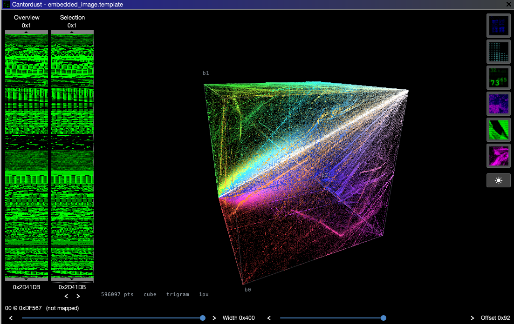
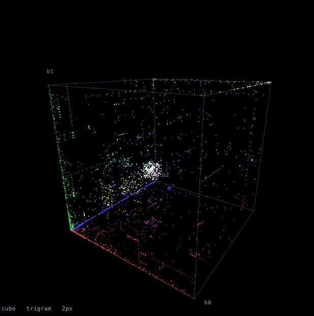
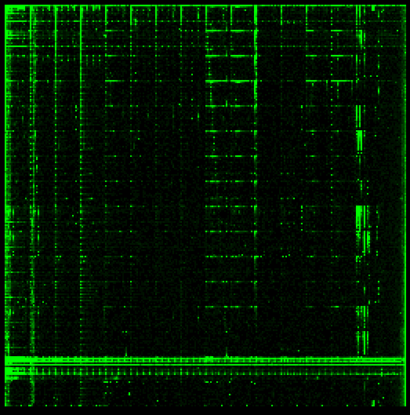
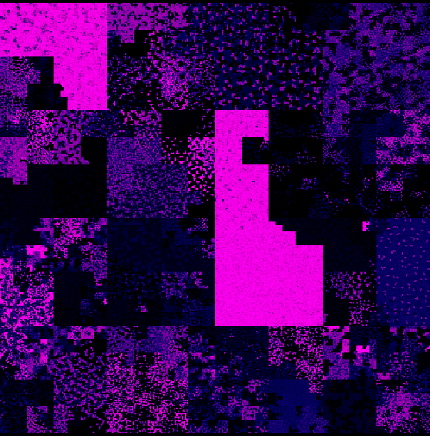
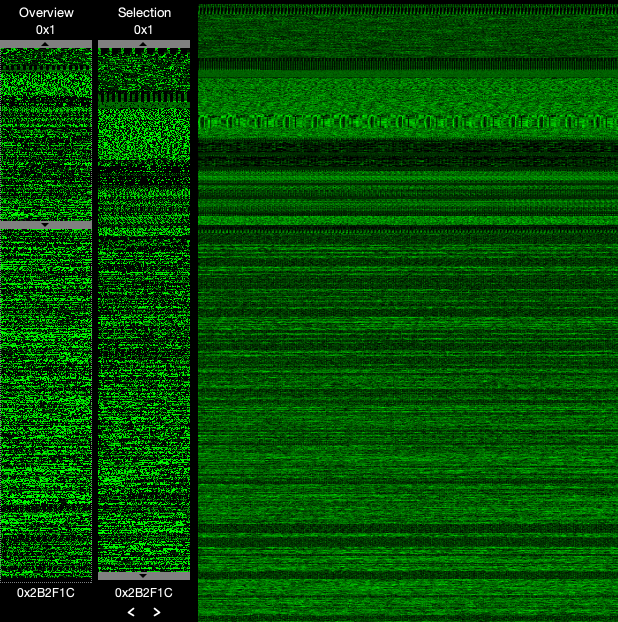

<h1 align="center">Cantordust-Ghidra</h1>

<p align="center">
  <strong>Binary visualization for Ghidra.</strong><br>
  See the shape of a file, then click straight through to the bytes that made it.
</p>

<p align="center">
  
</p>

<p align="center">
  <sub>Every three consecutive bytes of an embedded image as a point in a 256&sup3; cube.<br>
  Clicking a point reports the trigram and jumps the Ghidra listing to it.</sub>
</p>

<p align="center">
  <a href="#visualizations">Visualizations</a> &middot;
  <a href="#installation">Installation</a> &middot;
  <a href="#development">Development</a>
</p>

CantorDust is a binary visulization tool used to aid reverse engineering efforts. It allows humans to utilize their superior visual pattern recognition to identify patterns in binary data.

CantorDust (then ..cantor.dust..) was originally created by Chris Domas (xoreaxeaxeax), with funding from Battelle. The Ghidra plugin version of CantorDust was primarily developed by Battelle interns AJ Snedden and Mike Sengelmann with funding from Battelle. 

Take a look at [this blogpost](https://inside.battelle.org/blog-details/battelle-publishes-open-source-binary-visualization-tool) to learn more about the algorithms and history behind this tool.

## Visualizations

| | |
|:--:|:--:|
|  |  |
| **3-Tuple** — byte triples as points in a 256&sup3; cube | **2-Tuple** — byte pairs on a 256&times;256 grid |
|  |  |
| **Metric Map** — the file along a space-filling curve | **Linear BitMap** — the file as raster scanlines |

Also included: **1-Tuple**, byte values against position, and **Byte Cloud**, the
frequency of each byte value laid out as the hex table.

The **Overview** and **Selection** sliders on the left choose which part of the
file is drawn. Overview picks the window; Selection picks the range inside it.
Files larger than 25 MB are viewed through a 1 MB working window that a third
slider scrolls.

## Installation

Cantordust runs three ways. Pick one:

| | Best for | Needs |
|---|---|---|
| **Ghidra extension** | Everyday use inside the CodeBrowser | Ghidra 12.1 or later |
| **Ghidra script** | Hacking on Cantordust itself | Ghidra 9.1 or later, a clone of this repo |
| **Standalone app** | Looking at a file without opening Ghidra | Nothing (the app bundles its own Java runtime) |

Downloads for all three are on the
[Releases](https://github.com/Battelle/cantordust/releases) page.

> The extension and the script cannot be used in the same Ghidra at once. Ghidra
> exposes an installed extension's classes to every script, so a checkout of
> this repo registered as a script directory will no longer compile while the
> extension is installed. The script detects this and tells you to use the
> extension instead. Pick one, or uninstall the extension before running the
> script.

### As a Ghidra extension

1. Download `ghidra_<version>_PUBLIC_<date>_Cantordust.zip` from Releases. Do
   not unzip it; Ghidra reads the zip directly.
2. In the Ghidra project window choose **File &rarr; Install Extensions**, click
   the green **+**, pick the zip, click **OK**, and restart Ghidra when asked.
   - The zip is built against one Ghidra release. If yours differs, Ghidra
     warns and offers **Install Anyway**; that works across 12.x releases.
3. Open a program in the CodeBrowser and enable the plugin:
   **File &rarr; Configure &rarr; Configure All Plugins** (the plug icon in the
   top-right of the dialog), tick **CantordustPlugin**, click **OK**. This is
   needed once per tool.
4. Open Cantordust with **Window &rarr; Cantordust**, the Cantordust toolbar
   icon, or **Alt+C**.

The Cantordust window follows the program in the CodeBrowser: clicking a point
jumps the listing, and the window docks, floats, and is restored with the tool
like any other Ghidra component.

To remove it: **File &rarr; Install Extensions**, untick Cantordust, restart.

### As a Ghidra script

Use this if you want to edit Cantordust and see your changes without rebuilding
the extension.

1. Clone this repository.
2. Install Ghidra **9.1** or later from [ghidra-sre.org](https://ghidra-sre.org/)
   (see the [Installation Guide](https://ghidra-sre.org/InstallationGuide.html)).
3. Open Ghidra, open a program in the CodeBrowser, and open the Script Manager
   (the green play button in the toolbar, or **Window &rarr; Script Manager**).
4. Click the **Manage Script Directories** icon, click the green **+**, and add
   the cloned `cantordust/` directory.
5. Filter the Script Manager for `Cantordust.java`, select it, and click the
   green play button.

> Tick the **In Tool** box next to `Cantordust.java` to get a toolbar button,
> or right-click it to assign a key binding.

#### Updating the script

1. In your `cantordust/` checkout run `git pull`.
2. If Ghidra is already open, quit it and run `python3 cleanup.py`. Ghidra
   recompiles changed scripts by itself, but a session that has already loaded
   Cantordust goes on using the classes it started with.
3. Start Ghidra and launch Cantordust as usual. If a change still does not
   take effect, see *Ghidra Script Compilation* under *Development*.

### As a standalone application

The standalone app opens any file and offers every visualization. It has no
listing to jump to, so clicking a point selects the bytes in the built-in hex
view instead.

| Platform | Download | Install |
|---|---|---|
| macOS | `Cantordust-<version>.dmg` | Open the dmg and drag Cantordust to Applications. |
| Windows | `Cantordust-windows.zip` | Unzip anywhere and run `Cantordust\Cantordust.exe`. |
| Linux | `cantordust_<version>-1_amd64.deb` | `sudo apt install ./cantordust_<version>-1_amd64.deb`, then find Cantordust in the app menu or run `/opt/cantordust/bin/Cantordust`. |
| Any (Java 17+) | `cantordust.jar` | `java -jar cantordust.jar [file]` |

The native packages bundle a Java runtime, so nothing else is needed. The jar
needs Java 17 or later on your `PATH`.

Pass a file on the command line to open it directly, or use **File &rarr; Open**
(Ctrl+O, Cmd+O on macOS) once the app is up. The whole file is read into
memory; files over 25 MB are then viewed through the same 1 MB working window
as in Ghidra.

> **macOS:** the app is not notarized. The first launch may be blocked with
> *"Cantordust" cannot be opened because the developer cannot be verified*.
> Right-click the app and choose **Open**, or run
> `xattr -dr com.apple.quarantine /Applications/Cantordust.app` once.

## Development

Feel free to make modifications, changes and updates to this repository. Below are some tips on how to get started.

#### Ghidra Script API

The Ghidra API is your friend. When in ghidra go to: "Help", and select "Ghidra API Help". This will take you to an interactive html page which provides everything you need to know in order to interact with the API.

In order for Ghidra Scripts to work, the file that is run must extend GhidraScript like so:

```java
import ghidra.app.script.GhidraScript;
public class Cantordust extends GhidraScript { }
```

This class `Cantordust` is the only class that can interact with the API.

> When adding a new `.java` file to the repo, make sure you pass `cantordust` to it as a parameter in it's initialization. The only way you can print when testing a ghidra script, is by calling the class that extends GhidraScript and then calling your print statement. This will print in the Ghidra console. Example Below:

```java
cantordust.printf("");
```

#### Ghidra Script Compilation

Ghidra recompiles a script when its source changes, so a freshly started Ghidra
picks up your edits - including edits to the classes under `resources/`. A
session that already has Cantordust loaded is a different matter: the bundle is
resolved and its classes are in memory, and editing the source underneath it
will not dislodge them. After changing code, quit Ghidra, run `cleanup.py`, and
start it again.

If a change still appears not to apply, check the Ghidra console: when a compile
fails, Ghidra keeps running the last bundle that built successfully, which looks
a lot like a stale cache.

Since Ghidra 9.2 compiled scripts are stored as OSGi bundles under your user
settings directory, one bundle per source directory:

```txt
~/.ghidra/.ghidra_<version>/osgi/compiled-bundles/<hash>/
```

Later Ghidra versions moved this settings directory out of `~/.ghidra` to a
platform-specific location, so the path above is not fixed. To clear the cache
without hunting for it, run:

```sh
python3 cleanup.py            # remove bundles built from this checkout
python3 cleanup.py --dry-run  # show what would be removed
python3 cleanup.py --all      # remove every compiled bundle
```

The script searches the known settings locations, and only removes bundles
containing a class built from this checkout unless you pass `--all`. Use
`--settings-dir` if your Ghidra keeps settings somewhere else.

#### Building the extension and the standalone app

Both builds use the Gradle wrapper in the repository root and share the sources
under `resources/`. The script, the extension, and the app differ only in the
small `Host` implementation that feeds bytes in and takes clicks out.

**Standalone app** (JDK 17 or later; `jpackage` needs JDK 14+):

```sh
./gradlew jar           # build/libs/cantordust.jar
./gradlew jpackage      # build/jpackage/: a .dmg, .deb, or app-image for this OS
./gradlew checkLayouts checkJumps checkClassifier checkEntropy   # headless checks
```

**Ghidra extension** (JDK 21 and a Ghidra 12.1 install):

```sh
export GHIDRA_INSTALL_DIR=/path/to/ghidra_12.1.4_PUBLIC
./gradlew -p ghidra-extension      # ghidra-extension/dist/ghidra_..._Cantordust.zip
```

The build applies Ghidra's own `support/buildExtension.gradle`, so the zip
carries the exact Ghidra version it was compiled against in its name. Install it
with **File &rarr; Install Extensions** as described above. When reinstalling a
rebuilt zip, untick the old Cantordust first, click OK, then add the new zip.

The GitHub Actions workflow runs the headless checks on Linux, macOS, and
Windows, packages the app for each, builds the extension, and attaches all of
them to the release when a `v*` tag is pushed.

## License

Apache License 2.0. See [LICENSE](./LICENSE).